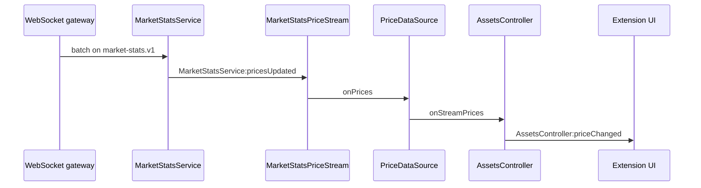

# Market stats

- Date: 2026-11-05
- Status: Accepted
- Package: `@metamask/assets-controller`

How a live spot price moves from the market-stats stream to the Extension
UI.

The poll (`/v3/spot-prices`) is the writer of `state.assetsPrice`. Socket
ticks are published as `AssetsController:priceChanged` and stay out of
controller state, so a tick does not become a Redux update. The decision
for that split is
[0060 — Real-time asset price streaming](https://github.com/MetaMask/decisions/blob/main/decisions/platform/0060-real-time-asset-price-streaming.md).

## Path



Held assets are subscribed from the account's balances, the same set the
price poll fetches. A screen that needs a price for an asset the account
does not track calls `MarketStatsService:subscribe` directly. That
subscription does not go through `AssetsController`.

What each layer owns (`PriceDataSource`, `MarketStatsPriceStream`,
`MarketStatsService`, `ChannelSubscriptionManager`) is in
[0060 — Real-time asset price streaming, Layers](https://github.com/MetaMask/decisions/blob/main/decisions/platform/0060-real-time-asset-price-streaming.md#layers).

## Backend

`market-stats-streams` lives in `platform-data-pipeline-librarian`,
package `internal/streams/markets/marketstats`.

It does not read prices from an external market API. `spotprices` writes
candles. This service waits until that write is visible on the Timescale
read replica, then publishes stats for assets that currently have a
subscriber.

1. Consume the chain's indexed spot-candle events.
2. Keep assets that match an active publish target. Targets are the
   gateway's live `market-stats` subscriptions, refreshed about every 5
   seconds. An indexed candle with no subscriber is dropped.
3. Queue the event. A tick (default 500ms) checks that the announced
   candle row is on the replica. One asset from the batch is enough: the
   indexer writes the batch in one transaction.
4. Load market stats as of that candle. Publish when the price is newer
   than the last publish for that asset. Overlapping events for the same
   asset collapse to the newest candle.
5. Convert USD stats into each target currency and publish one NATS
   message per asset and currency.

The NATS subject is `market-stats.v1.<asset>.<currency>`. `:` and `/` in
the CAIP-19 asset id are replaced with `.` so the id is a valid subject.
Example: `eip155:1/slip44:60` in USD is
`market-stats.v1.eip155.1.slip44.60.usd`.

Each message is one asset:

| Field                                    | Meaning                             |
| ---------------------------------------- | ----------------------------------- |
| `assetId`                                | CAIP-19 asset id                    |
| `currency`                               | Fiat code the numbers are quoted in |
| `price`, `priceAt`                       | Spot price and its time             |
| `high24h`, `low24h`                      | 24h range                           |
| `volume24h`, `volume1h`                  | Volume in that currency             |
| `pricePercentChange5m`, `1h`, `4h`, `1d` | Price change over those windows     |

The WebSocket gateway is what the client talks to. Clients subscribe to
`market-stats.v1.<assetId>.<currency>` (CAIP-19, slashes kept). The
gateway delivers price changes as one batch on the top-level channel
`market-stats.v1`, about every 30 seconds, and chain health on
`system-notifications.v1.market-stats.v1`.

## MarketStatsService

`MarketStatsService` (`@metamask/core-backend`) is the wallet-side client
for that socket. It shares `BackendWebSocketService` with the other
backend streams. Extension constructs it before `AssetsController` and
calls `init()` immediately. `init()` returns without throwing when the
WebSocket service is not registered yet; call it again once that service
exists.

`subscribe({ assetId, currency })` opens
`market-stats.v1.<assetId>.<currency>`. The first caller sends the
WebSocket subscribe. Further callers for the same channel only increment
a reference count. `unsubscribe` decrements it and, at zero, waits a
grace period before the socket unsubscribe. A subscribe issued while the
socket is still waiting on the bearer token is kept and sent when the
socket connects.

Price changes do not arrive on the per-asset channel. The service
listens on `market-stats.v1`, parses the batch, and publishes
`MarketStatsService:pricesUpdated`. Entries without an asset id,
currency, and finite price are dropped. The client keeps `price` and
`pricePercentChange1d`. The rest of the backend payload (high, low,
volume, shorter windows) is not forwarded.

| Event                                   | Payload                                           |
| --------------------------------------- | ------------------------------------------------- |
| `MarketStatsService:pricesUpdated`      | `{ updates, timestamp }`                          |
| `MarketStatsService:chainStatusChanged` | `{ chainIds, status: 'up' \| 'down', timestamp }` |
| `MarketStatsService:subscriptionError`  | `{ channel, error, operation }`                   |

A rejected subscribe drops that channel and publishes
`subscriptionError`. It does not reconnect the shared socket. On
disconnect, every chain the service had marked up is published as
`down`.

A session may hold at most 200 market-stats channels
(`MARKET_STATS_MAX_CHANNELS`). This service does not choose which 200.
`MarketStatsPriceStream` does.

## AssetsController

`PriceDataSource` owns the Price API poll and the set of assets to
price. `MarketStatsPriceStream` owns which of those assets are on the
socket. `AssetsController` publishes the result.

### Who gets a channel

Every spot-price request sets `includeWssSupportField: true`. The Price
API omits `wssSupport` without that flag, and then no channel is opened.
The response also carries 24h `totalVolume`. Both are remembered per
asset.

`selectAssetsToStream` keeps assets with `wssSupport: true`, then the
highest 24h volume, then asset id as the tie-break. The first 200 win a
channel. The rest stay on the poll. This cap applies only to the assets
`AssetsController` tracks. A direct `MarketStatsService` subscription is
a separate channel on the same socket and counts toward the session limit
of 200.

### Two ways a price is delivered

**Socket.** `MarketStatsPriceStream` opens the tracked channels in one
`MarketStatsService:subscribe` call, then listens to
`MarketStatsService:pricesUpdated`. A tick is applied when the currency
matches `selectedCurrency`, the asset is in the subscribed set, and its
chain is not marked down. The tick is merged onto the last fungible
price in `assetsPrice` (so USD price and 24h change survive a non-USD
tick). A non-USD tick with no stored price is skipped. USD ticks set
`usdPrice` from the tick.

`PriceDataSource` hands that object to `onStreamPrices`.
`AssetsController` publishes `AssetsController:priceChanged` and does
not call `#updateState`. `assetsPrice` is unchanged.

**Poll.** The default interval is 60 seconds. A poll fetches
`/v3/spot-prices` for assets `shouldPoll` says still need it, merges
them into `assetsPrice`, and publishes `priceChanged` for the prices
that actually changed. That publish is the same event as a socket tick.
A listener cannot tell them apart from the payload, and does not need
to.

`shouldPoll` is true when streaming is unavailable, the asset was never
subscribed, the subscribe was rejected, or the chain is down and the
jitter window has elapsed. A subscribed asset on a healthy chain is left
to the socket.

| Asset                               | Channel                         | `assetsPrice`                        | How the UI hears it                  |
| ----------------------------------- | ------------------------------- | ------------------------------------ | ------------------------------------ |
| `wssSupport`, inside the 200        | Yes                             | Poll only, until the channel is open | `priceChanged` from the socket       |
| No `wssSupport`                     | No                              | Each poll                            | `priceChanged` after the state write |
| Past the 200-channel cap            | No                              | Each poll                            | `priceChanged` after the state write |
| Subscribe rejected                  | No, for the rest of the session | Each poll                            | `priceChanged` after the state write |
| Chain reported down                 | Stays open, ticks ignored       | Poll after a short random delay      | `priceChanged` after the state write |
| `MarketStatsService` not registered | No                              | Every asset, every poll              | `priceChanged` after the state write |

A down chain waits `random * min(pollInterval, 5000)` ms before the
first fallback poll, so clients do not all hit the Price API together.
When the chain is reported up, the next poll runs immediately and
streaming resumes.

### Tracked assets

Tracked assets come from balance state, the same ids the price poll
fetches. `PriceDataSource.subscribe` polls them and reconciles the socket
set after each poll. That is the homepage and token list path. Those
screens do not open their own market-stats channel.

The Extension reads those ticks from `AssetsController:priceChanged` in
`ui/hooks/assets/live-asset-prices.ts`. That module keeps a map outside
Redux and notifies React through `useSyncExternalStore`. EVM asset ids
are stored lowercased, matching the token list lookup.

| Hook / helper                | Used by                   | What it does                                                        |
| ---------------------------- | ------------------------- | ------------------------------------------------------------------- |
| `useLiveAssetPrices`         | Token list, account total | The current map. Empty until the first tick.                        |
| `useLiveAssetPrice(assetId)` | Asset page                | One price from that map.                                            |
| `applyLiveTokenFiat`         | Token list                | Replaces the row fiat balance with `balance * livePrice`.           |
| `liveFiatDelta`              | Account group balance     | Adds `balance * livePrice - polledFiat` on top of the polled total. |

The token list and the account total do not subscribe per asset. They
read ticks for assets the balance pipeline already streams. Until a
tick arrives they show the polled fiat value from Redux.

`AssetsController:syncAssetsPrices` is separate. It is a one-shot fetch
that does merge into `assetsPrice`. Use it when a caller needs the
stored snapshot itself to be current.

## A price the account does not track

Explore, Discover search, the asset page, and any other screen that shows
a price for a token with no balance row subscribes on
`MarketStatsService`. `AssetsController` does not see that subscription
and does not publish `priceChanged` for it.

`MarketStatsService` reference-counts each
`market-stats.v1.<assetId>.<currency>` channel. The first caller opens
the socket subscription. Further callers for the same channel only
increment the count. `unsubscribe` decrements it. Pass the selected
currency. When the currency changes, unsubscribe the old pair and
subscribe the new one.

```typescript
await messenger.call('MarketStatsService:subscribe', {
  assetId, // CAIP-19
  currency, // selected currency, e.g. "usd"
});
```

On cleanup:

```typescript
await messenger.call('MarketStatsService:unsubscribe', {
  assetId,
  currency,
});
```

Ticks arrive on `MarketStatsService:pricesUpdated` as
`{ updates, timestamp }`. Each update has `assetId`, `currency`,
`price`, and `pricePercentChange1d`. Keep the ids you subscribed and
ignore the rest. Nothing is written to `assetsPrice`.

An asset with no `wssSupport` has no socket channel. This path does not
fall back to the Price API poll. The screen keeps its own snapshot until
a tick arrives. The asset page still does its own one-shot spot-price
fetch for the first number.

Subscribing a large catalog uses the same 200-channel session cap as the
tracked-asset stream. Subscribe the rows on screen, and drop an id when
the user leaves.

### One asset

The Extension asset page does this with `useWatchAssetPrice(assetId)`,
which calls `MarketStatsService:subscribe` on mount and `unsubscribe` on
cleanup. `useLiveAssetPrice` reads the latest tick from a map filled by
`pricesUpdated` for those direct subscriptions, and by
`AssetsController:priceChanged` for tracked assets.

### A list, such as Explore

Subscribe the visible ids once from the screen, not once per row. A
virtualized row mounts and unmounts as the user scrolls, and a per-row
watch would open and close channels on every scroll.

```typescript
submitRequestToBackground('messengerCall', [
  'MarketStatsService:subscribe',
  [{ assetId, currency }],
]);
```

Read one row from the shared map. `readLiveQuote` lowercases EVM ids,
which is how the token list looks them up. Fall back to the feed price
until a tick exists:

```typescript
const live = readLiveQuote(livePrices, asset.assetId)?.price;
const price = live ?? Number(asset.price);
```

When the visible ids change, subscribe only the ids that were added and
unsubscribe only the ids that left. The socket unsubscribe waits a grace
period, so a channel survives if the new subscribe lands in that window.

### Mobile

Mobile has no shared hook yet. The calls are the same, on the engine
messenger:

```typescript
await Engine.controllerMessenger.call('MarketStatsService:subscribe', {
  assetId,
  currency,
});

const unsubscribe = Engine.controllerMessenger.subscribe(
  'MarketStatsService:pricesUpdated',
  ({ updates }) => {
    // updates[].price, in `updates[].currency`
  },
);
```

Call `MarketStatsService:unsubscribe` with the same asset and currency
when the screen unmounts, and call the returned `unsubscribe` to stop
listening.
