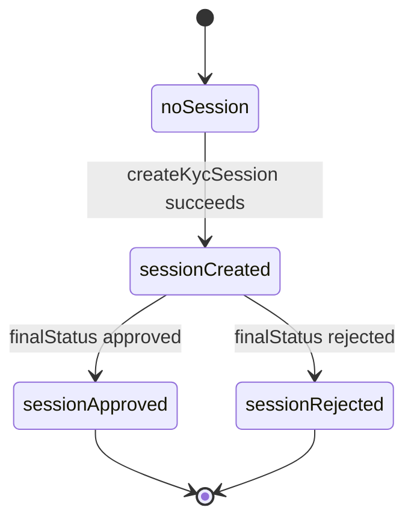
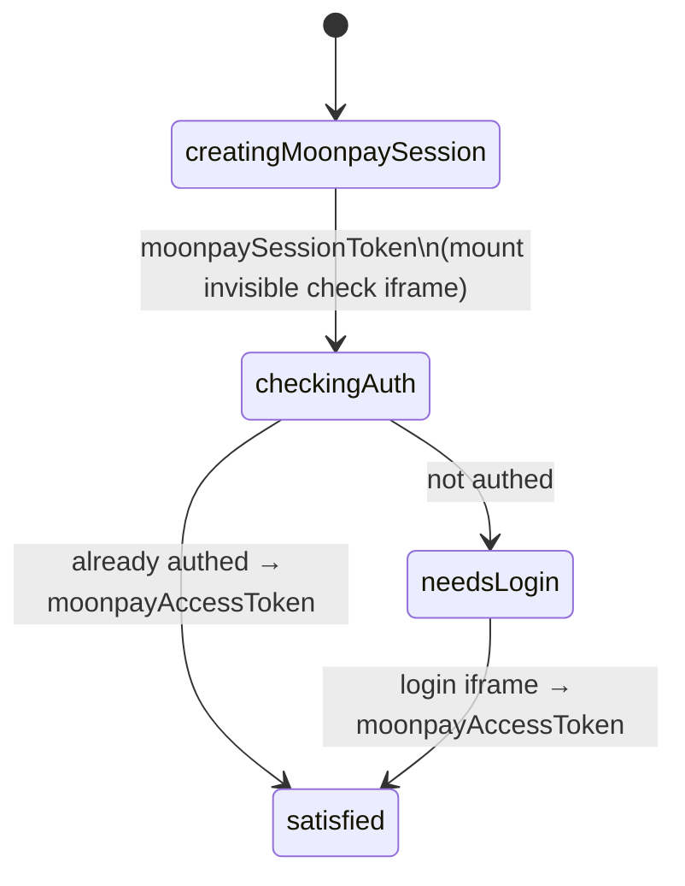
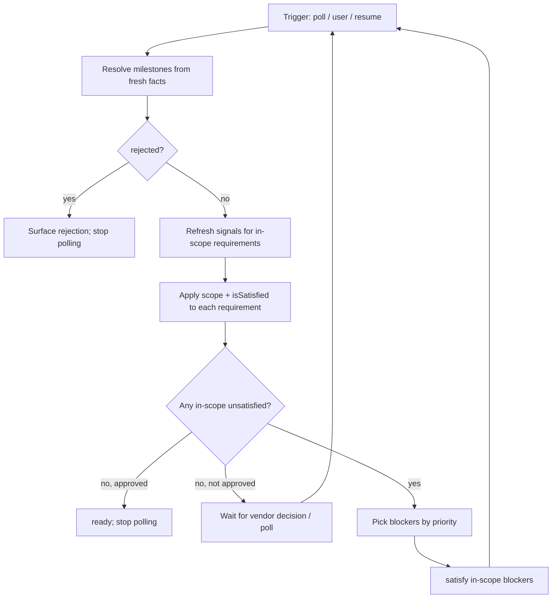

# Multi-vendor KYC flow architecture

Target architecture for generalizing `@metamask/kyc-controller` across multiple
identity vendors (Iron, MoonPay, Kalshi, and future vendors) without growing a
single shared phase enum per vendor quirk.

This document describes the **intended** model. The current package still
centers on a linear `KycPhase` machine plus vendor-specific branches; see
[`ARCHITECTURE.md`](../ARCHITECTURE.md) for the as-shipped MoonPay / Iron
implementation.

---

## 1. Goals

| Goal                              | Meaning                                                                                                                                                                                                                             |
| --------------------------------- | ----------------------------------------------------------------------------------------------------------------------------------------------------------------------------------------------------------------------------------- |
| Vendor-neutral consumer surface   | Clients drive initialize / resume / SumSub presentation without vendor-branded public APIs.                                                                                                                                         |
| Cheap vendor deltas               | A new vendor is mostly a declaration of which requirements apply, plus any truly nested UX (e.g. MoonPay iframes).                                                                                                                  |
| Backend-authoritative resume      | After backgrounding, process death, or clean reinstall, the client rediscovers truth from kyc-api and remints local secrets.                                                                                                        |
| Rewind without a rewind graph     | Requirements that become unsatisfied again are handled by recomputing satisfaction — not by encoding “jump back to gate X.”                                                                                                         |
| Requirements scoped to milestones | Each requirement matters only between session milestones. After its retirement milestone, its inputs may expire or change without forcing a rewind (e.g. aal2 after session creation; capability authorization after the decision). |
| Independent post-session work     | Vendor disclaimers, session disclaimers, and capability authorization are independently checkable and may become unsatisfied again until the session is decided.                                                                    |
| Vendor work after approval        | A vendor may need more than an approved KYC session before the customer can use it (Iron: the account must be `Active`). Consumers key off a derived `ready` phase, not `finalStatus: approved`.                                    |

---

## 2. Why not one flat state machine per stage

A shared enum of every vendor stage (`check`, `auth`, Kalshi email OTP, phone
OTP, Iron account activation, …) forces every client to special-case states it
will never see and makes illegal transitions / resume / expiry hard to test.

| Approach                                                | Fits when                                                                                                    | Fails when                                                        |
| ------------------------------------------------------- | ------------------------------------------------------------------------------------------------------------ | ----------------------------------------------------------------- |
| Flat shared `KycPhase`                                  | One mostly linear vendor                                                                                     | Multiple vendors with different optional stages                   |
| Per-vendor state machines                               | Vendors share little structure                                                                               | Iron / MoonPay / Kalshi are “same spine + small deltas”           |
| Ordered gate pipeline only                              | Strict once-through order                                                                                    | Disclaimers / capability are independent and can flip false again |
| **Requirement set + milestones + recompute** (this doc) | Shared spine, optional requirements, resume, rewind, requirements that stop or start mattering at milestones | Nested client UX still needs a small private sub-flow (MoonPay)   |

A coarse **derived** UI phase (`idle` / `needsUser` / `processing` / `ready` /
`rejected`) is still useful. Vendor-specific stages live inside requirements
(or nested sub-flows), not on the public phase type.

When only one requirement is false, “jump to X then walk forward” and
“recompute; do whatever is false” look the same to the user. They diverge when
multiple requirements fail, when fixing one must not replay still-valid work,
or when another requirement flips while the user is fixing the first. Resume
after restart is the strongest reason to prefer recompute: the backend may have
moved without any local cursor update.

---

## 3. Core model

### 3.1 Session milestones

A UKYC session moves through three milestones. All are **derived from fresh
backend facts**, not stored as local flags.

| Milestone         | Holds when                                                     | Source                                                                      |
| ----------------- | -------------------------------------------------------------- | --------------------------------------------------------------------------- |
| `sessionCreated`  | A UKYC session resolves for the active vendor                  | persisted `sessionStatus.id` confirmed by kyc-api, or vendor session lookup |
| `sessionDecided`  | `sessionCreated` and `finalStatus` is `approved` or `rejected` | `GET /sessions/{id}/status`                                                 |
| `sessionApproved` | `sessionCreated` and `finalStatus` is `approved`               | `GET /sessions/{id}/status`                                                 |

`sessionApproved` implies `sessionDecided`, which implies `sessionCreated`.

**The backend is always the source of truth.** By kyc-api contract, a
session’s `approved` / `rejected` status is final. The client does **not**
enforce that contract: milestones are always derived from the latest kyc-api
response. If kyc-api later reports a non-final status for the same session,
`sessionDecided` and `sessionApproved` no longer hold and post-session
requirements come back into scope.

`sessionDecided` uses the same set as `FINAL_STATUSES_TO_SKIP_AUTH_REFRESH`
today (`approved`, `rejected`). It deliberately **excludes** `retry`, which is
in `TERMINAL_SESSION_STATUSES` (polling stops) but does not end the
applicant’s work. See [§12](#12-open-questions).



(`sessionRejected` in the diagram is `sessionDecided` without
`sessionApproved`; it is not a separate milestone.)

MoonPay’s own “moonpay session” (session token → check/login iframes → access
token) is **not** a UKYC session and is not a milestone. It is a nested
sub-flow inside the `moonpayAccessToken` requirement.

### 3.2 Requirements are in scope between milestones

Each unit of work is a **requirement** with a scope window:

```typescript
type RequirementId = string;

type Milestone = 'sessionCreated' | 'sessionDecided' | 'sessionApproved';

type RequirementResult = 'satisfied' | 'needsUser' | 'processing' | 'failed';

type Requirement = {
  id: RequirementId;
  /** Milestone that brings this requirement into scope. Omitted: in scope from the start. */
  activeFrom?: Milestone;
  /** Milestone that retires this requirement. Omitted: stays in scope once active. */
  retiredAt?: Milestone;
  /** True iff this work is currently done. Only consulted while in scope. */
  isSatisfied: (ctx: VendorFlowContext) => boolean;
  /** Advance toward satisfaction when in scope and unsatisfied. */
  satisfy: (ctx: VendorFlowContext) => Promise<RequirementResult>;
};
```

Evaluation rule, applied to every requirement on every evaluation:

```text
if activeFrom is set and not reached:   not yet in scope — skip
else if retiredAt is set and reached:   retired — skip; never blocks
else if isSatisfied(ctx):               ok
else:                                   blocker — run satisfy / surface to UI
```

While a requirement is in scope it is **always re-checked**. It can be
satisfied, flip false (expired token, stale disclaimer, vendor account no
longer active), and be satisfied again. Once its `retiredAt` milestone holds,
its underlying inputs are irrelevant: they may expire, be wiped, or disappear
from local storage.

Retirement is **not** “remember this was once true.” It is “the milestone that
made this requirement pointless has been reached.” Because milestones are
derived from fresh backend facts, retirement survives restart and reinstall
without any local bookkeeping.

### 3.3 The windows

| Window        | `activeFrom`      | `retiredAt`      | Requirements                                                                                                                   |
| ------------- | ----------------- | ---------------- | ------------------------------------------------------------------------------------------------------------------------------ |
| Pre-session   | —                 | `sessionCreated` | `aal2`, `identitySharingConsent`, `partnerIdentityToken`, `moonpayAccessToken`, `createKycSession`                             |
| Post-session  | `sessionCreated`  | `sessionDecided` | `vendorDisclaimers`, `sessionDisclaimers`, `capabilityAuthorization`, `kalshiEmailOtp`, `kalshiPhoneOtp`, `sumsubJourneyStart` |
| Post-approval | `sessionApproved` | —                | `ironAccountActive`                                                                                                            |

A rejected session never reaches `sessionApproved`, so post-approval
requirements never come into scope for it. Nothing is left to satisfy; the
outcome is `rejected`.

**Pre-session requirements** exist only to create the UKYC session.

| Requirement                         | Why it can disappear later without a rewind             |
| ----------------------------------- | ------------------------------------------------------- |
| `aal2`                              | aal2Token may expire with no user action                |
| `identitySharingConsent`            | consent artifacts / tokens may become unavailable       |
| `partnerIdentityToken`              | short-lived mint; only consumed by session create       |
| `moonpayAccessToken` (MoonPay only) | MoonPay session secret; only consumed by session create |

`createKycSession` is the requirement that reaches `sessionCreated`. It
retires itself by succeeding.

**Post-session requirements** exist only to reach a decision.

| Requirement                         | Can flip false while in scope                                           | After `sessionDecided`                                                                                                           |
| ----------------------------------- | ----------------------------------------------------------------------- | -------------------------------------------------------------------------------------------------------------------------------- |
| `vendorDisclaimers`                 | Catalog version moves; accepted ids no longer current                   | The catalog is not re-checked. For Iron, re-signing after approval is driven by the account status instead (`ironAccountActive`) |
| `sessionDisclaimers`                | Session catalog / consent flags change                                  | Same                                                                                                                             |
| `capabilityAuthorization`           | Status moves to `expired` or `wiped`                                    | Expiry is ignored (matches `needsCapabilityAuthorizationRefresh` today)                                                          |
| `kalshiEmailOtp` / `kalshiPhoneOtp` | Backend `currentStep` demands OTP (again)                               | OTP is never requested                                                                                                           |
| `sumsubJourneyStart`                | Documents still required; journey token must be refetched after restart | SumSub is never launched                                                                                                         |

**Post-approval requirements** exist so the customer can actually use the
vendor after KYC succeeds.

`ironAccountActive` (Iron only) is driven by the Iron account status. `Active`
is the target status; the requirement is satisfied exactly when the account
is `Active`.

| Iron account status | Requirement | `satisfy`                                                                                                                                                                                                              |
| ------------------- | ----------- | ---------------------------------------------------------------------------------------------------------------------------------------------------------------------------------------------------------------------- |
| `Active`            | satisfied   | —                                                                                                                                                                                                                      |
| `SigningsRequired`  | unsatisfied | `needsUser`: fetch the current Iron vendor disclaimers, have the applicant accept them, and submit them again (`POST /vendors/iron/disclaimers`, the same submission `vendorDisclaimers` uses). Then wait for `Active` |
| any other status    | unsatisfied | `processing`: wait and poll                                                                                                                                                                                            |

It has no `retiredAt`. It reflects live vendor state, and the backend is the
source of truth, so the flow keeps treating it as in scope after it is
satisfied. If the account later reports `SigningsRequired`, the applicant is
asked to re-sign; if it reports another non-`Active` status, the phase goes
back to `processing`.

Re-signing is modeled inside `ironAccountActive` rather than by keeping
`vendorDisclaimers` in scope after the decision. The two use different
signals: before the decision the disclaimer catalog says whether acceptance is
current; after approval the Iron account status says so. Sharing the
submission code keeps the UX identical without giving one requirement two
sources of truth.

### 3.4 Flow outcome: `ready`

A session is **`ready`** when `sessionApproved` holds **and** every
post-approval requirement for the vendor is satisfied.

- MoonPay and Kalshi have no post-approval requirements, so `ready` is the
  same as `approved`.
- Iron is `approved` but not `ready` until the account is `Active`.

Consumers that gate product access (ramps, card, money) must key off `ready`,
not `finalStatus: approved`. That keeps the Iron-specific wait out of every
consumer.

### 3.5 Vendor flow definition

Vendors are data composed from a shared library of requirements. Each
requirement carries its own window, so a vendor only lists which requirements
apply:

```typescript
type VendorFlowDefinition = {
  vendor: 'iron' | 'moonpay' | 'kalshi';
  /** Claims required on the partner identity token. */
  partnerIdentityClaims: ReadonlyArray<'email' | 'phoneNumber'>;
  requirements: RequirementId[];
};
```

Iron is the base case. MoonPay and Kalshi differ by small deltas.

---

## 4. Vendor matrices

### 4.1 Pre-session window (retired at `sessionCreated`)

| Requirement                                              | Iron | MoonPay | Kalshi |
| -------------------------------------------------------- | ---- | ------- | ------ |
| `aal2` (aal2Token)                                       | ✓    | ✓       | ✓      |
| `identitySharingConsent` (`granted: true` for vendor)    | ✓    | ✓       | ✓      |
| `partnerIdentityToken` with `email`                      | ✓    | ✓       | ✓      |
| `partnerIdentityToken` with `phoneNumber`                |      |         | ✓      |
| `moonpayAccessToken` (via MoonPay session + check/login) |      | ✓       |        |
| `createKycSession` (reaches `sessionCreated`)            | ✓    | ✓       | ✓      |

### 4.2 Post-session window (retired at `sessionDecided`)

| Requirement                                             | Iron | MoonPay | Kalshi |
| ------------------------------------------------------- | ---- | ------- | ------ |
| `vendorDisclaimers`                                     | ✓    | ✓       | ✓      |
| `sessionDisclaimers`                                    | ✓    | ✓       | ✓      |
| `capabilityAuthorization`                               | ✓    | ✓       | ✓      |
| `kalshiEmailOtp` (vendor OTP, not MetaMask aal2 OTP)    |      |         | ✓      |
| `kalshiPhoneOtp`                                        |      |         | ✓      |
| `sumsubJourneyStart` (fetch journey token → launch SDK) | ✓    | ✓       | ✓      |

`vendorDisclaimers`, `sessionDisclaimers`, and `capabilityAuthorization` are
**independently checkable**.

`sumsubJourneyStart` is a **guarded advance**: it may run only when every other
in-scope post-session requirement is satisfied _on the current evaluation_.

### 4.3 Post-approval window (from `sessionApproved`, no retirement)

| Requirement         | Iron | MoonPay | Kalshi |
| ------------------- | ---- | ------- | ------ |
| `ironAccountActive` | ✓    |         |        |

### 4.4 Declarative definitions (illustrative)

```typescript
const SHARED_PRE_SESSION = [
  'aal2',
  'identitySharingConsent',
  'partnerIdentityToken',
] as const;

const SHARED_POST_SESSION = [
  'vendorDisclaimers',
  'sessionDisclaimers',
  'capabilityAuthorization',
] as const;

const IRON: VendorFlowDefinition = {
  vendor: 'iron',
  partnerIdentityClaims: ['email'],
  requirements: [
    ...SHARED_PRE_SESSION,
    'createKycSession',
    ...SHARED_POST_SESSION,
    'sumsubJourneyStart',
    'ironAccountActive',
  ],
};

const MOONPAY: VendorFlowDefinition = {
  vendor: 'moonpay',
  partnerIdentityClaims: ['email'],
  requirements: [
    ...SHARED_PRE_SESSION,
    'moonpayAccessToken',
    'createKycSession',
    ...SHARED_POST_SESSION,
    'sumsubJourneyStart',
  ],
};

const KALSHI: VendorFlowDefinition = {
  vendor: 'kalshi',
  partnerIdentityClaims: ['email', 'phoneNumber'],
  requirements: [
    ...SHARED_PRE_SESSION,
    'createKycSession',
    ...SHARED_POST_SESSION,
    'kalshiEmailOtp',
    'kalshiPhoneOtp',
    'sumsubJourneyStart',
  ],
};
```

List order is a UI priority hint only. Progress comes from evaluating scope
and satisfaction, not from a position in the list.

---

## 5. Nested sub-flows (keep private)

### 5.1 MoonPay access token

Only MoonPay needs this. It must **not** leak into the shared public phase
enum. Implement it entirely inside `moonpayAccessToken.satisfy`:



Notes:

- A MoonPay session is with MoonPay directly; it is distinct from the UKYC
  session created afterward.
- Retired at `sessionCreated`, same as aal2. After create succeeds, an expired
  or missing `moonpayAccessToken` does not rewind the flow.
- Before create, after app restart: if `sessionCreated` does not hold and the
  access token is missing, re-run this sub-flow. Do not resume mid-iframe from
  a persisted phase.

### 5.2 Kalshi OTP

Model Kalshi email/phone OTP as first-class post-session requirements driven
by kyc-api `currentStep` (or equivalent), not as a second public state
machine. Use a nested machine only if the client UX is as stateful as MoonPay
frames.

If the API forces email before phone, those two requirements may be ordered
relative to each other; they still must not be artificially serialized behind
disclaimers or capability unless the API requires that.

Both retire at `sessionDecided`. A decided session never prompts for Kalshi
OTP, even if `currentStep` is stale.

### 5.3 Iron account activation

`ironAccountActive` is a status dispatch, not a nested machine. `isSatisfied`
reads the account status; `satisfy` either runs the vendor disclaimer
re-signing (`SigningsRequired`) or returns `processing` and lets the evaluate
loop poll. Account statuses do not appear on the public phase type: the
applicant sees `needsUser` while re-signing is needed, `processing` while
waiting, and `ready` once the account is `Active`.

---

## 6. Engine: recompute, don’t walk a cursor

### 6.1 Evaluate loop

On every trigger (user action, status poll tick, disclaimer refresh, app
foreground, cold start, reinstall discovery):

1. Resolve milestones from fresh facts: does a UKYC session exist for the
   vendor (`sessionCreated`)? Is its `finalStatus` `approved` or `rejected`
   (`sessionDecided`, `sessionApproved`)?
2. If the session is rejected: stop. Every requirement is retired or out of
   scope. Stop polling and surface the decision.
3. Otherwise, refresh authoritative signals for in-scope requirements only.
   Skip fetches that serve retired or not-yet-active requirements (no aal2
   refresh once `sessionCreated` holds; no disclaimer or capability refresh
   once `sessionDecided` holds; no Iron account fetch before
   `sessionApproved`).
4. Apply the evaluation rule from [§3.2](#32-requirements-are-in-scope-between-milestones)
   to every requirement in the vendor definition.
5. If `sessionApproved` holds and no in-scope requirement is unsatisfied, the
   session is `ready`. Stop polling.
6. Among in-scope unsatisfied requirements, choose what to surface or run
   (list order as priority for `needsUser`, or parallel where safe).
7. When every in-scope post-session requirement except SumSub is satisfied,
   allow `sumsubJourneyStart`. If one flips false while SumSub is in flight,
   block or unwind according to product rules.



Polling therefore stops at `ready` or `rejected`, not at `approved`. For Iron,
polling continues after approval until the account is `Active`. While the
account is `SigningsRequired`, there is nothing to poll for until the
applicant submits the disclaimers.

### 6.2 Fast-forward

Fast-forward is automatic: after fixing one blocker, the next evaluation skips
every requirement that is still satisfied, not yet in scope, or retired. Do
not store a “current gate index” and replay subsequent steps as a pipeline.

### 6.3 Events and engine behavior

| Event                                                                                                                        | Engine behavior                                                                                                                                  |
| ---------------------------------------------------------------------------------------------------------------------------- | ------------------------------------------------------------------------------------------------------------------------------------------------ |
| In-scope requirement flips false (stale disclaimer, expired capability)                                                      | Re-enter that requirement; user may see a rewind                                                                                                 |
| Pre-session input expires after `sessionCreated` (aal2, partner identity, MoonPay token)                                     | Ignore; requirement is retired                                                                                                                   |
| Post-session input expires or changes after `sessionDecided` (capability expired, new disclaimer version, OTP step reported) | Ignore; requirement is retired. Iron re-signing after approval comes only from the account reporting `SigningsRequired`                          |
| Session becomes decided while the user is mid-requirement (e.g. disclaimer screen open)                                      | Requirement retires; discard its in-flight `satisfy` result (generation guard); drop the blocker and show the decision or the post-approval wait |
| Iron session is approved and the account is neither `Active` nor `SigningsRequired`                                          | `processing`; keep polling                                                                                                                       |
| Iron account reports `SigningsRequired` (before or after `ready`)                                                            | `needsUser`: re-sign the current Iron vendor disclaimers, then poll for `Active`                                                                 |
| Iron account leaves `Active` for another status after `ready`                                                                | Follow the backend: the requirement is unsatisfied again and the phase goes back to `processing`                                                 |
| kyc-api reports a non-final status for a session the client already observed as `approved` / `rejected`                      | Follow kyc-api: `sessionDecided` no longer holds, post-session requirements come back into scope, and polling resumes                            |
| `createKycSession` fails                                                                                                     | `sessionCreated` does not hold; keep evaluating pre-session (including reminting expired aal2)                                                   |
| `satisfy` returns `failed` for an in-scope requirement                                                                       | Product policy: retry, reset, or wait for the session decision                                                                                   |

Avoid encoding “SumSub failed ⇒ always return to terms” as a global phase edge
if the accurate model is “recompute in-scope requirements.”

---

## 7. Resume after restart, background, and reinstall

### 7.1 Contract

Local progress is at best a hint. On cold start, foreground, or first KYC
entry after reinstall:

1. Resolve whether a UKYC session exists for the active vendor (persisted
   `sessionStatus.id` if present; otherwise vendor session lookup via kyc-api).
2. **No session:** evaluate the pre-session window. Remint ephemeral secrets
   (aal2 if needed, partner identity token, MoonPay tokens, frame keypairs).
3. **Session exists:** fetch a **fresh** session status. A persisted status
   may be shown while the fetch is in flight, but the fresh response decides
   which requirements are in scope.
   - `rejected`: ask for nothing; surface the decision.
   - `approved`: ask for nothing from the pre- or post-session windows.
     Evaluate the post-approval window (Iron: fetch the account status).
     `ready` if it is empty or satisfied; `needsUser` if the Iron account is
     `SigningsRequired`; otherwise `processing`.
   - otherwise: evaluate the post-session window. Do **not** demand aal2,
     identity-sharing consent, or partner/MoonPay tokens because they are
     missing locally.
4. Launch SumSub only if the evaluation allows it.

| Scenario                                                     | Milestone reached | Behavior                                                                           |
| ------------------------------------------------------------ | ----------------- | ---------------------------------------------------------------------------------- |
| Background → foreground, session undecided                   | `sessionCreated`  | Refresh session; evaluate post-session window                                      |
| Background → foreground, session rejected while backgrounded | `sessionDecided`  | Show rejection; nothing to satisfy                                                 |
| Background → foreground, session approved while backgrounded | `sessionApproved` | Evaluate post-approval window; `ready` or keep waiting                             |
| Process kill / restart, session id still valid               | any               | Same as above; ignore expired local aal2 / MoonPay tokens                          |
| Clean reinstall, backend has an undecided session            | `sessionCreated`  | Remint nothing for create; evaluate post-session window                            |
| Clean reinstall, backend has an approved session             | `sessionApproved` | No aal2, consent, disclaimers, or capability needed; evaluate post-approval window |
| Clean reinstall, backend has a rejected session              | `sessionDecided`  | Show rejection                                                                     |
| Clean reinstall, no backend session                          | none              | Full pre-session path                                                              |

### 7.2 Persistence rules

**Persist (recovery keys / UX cache, not sole authority):**

- Active `vendor`
- UKYC `sessionStatus.id` (last-known status only as a display cache). It is
  the local hint for every milestone; confirm with kyc-api when possible
- Optional product / analytics hints
- Disclaimer acceptance records as **optimistic caches** keyed by document
  identity/version. Re-compare to the current catalog / `consented` flags
  before treating an in-scope disclaimer requirement as satisfied
- Last-known Iron account status, as a display cache only

**Do not treat as durable progress across resume:**

- Linear `phase` / current gate index
- A local “retired” or “ready” flag. Retirement and readiness come from
  milestones and requirement checks, which come from backend facts. This
  includes a persisted `approved` / `rejected` status or a persisted `Active`
  account status: they are display caches, not facts the client holds onto
  against a newer backend response
- aal2 / partner identity / MoonPay tokens as proof that create may be skipped
  (only a resolvable UKYC session skips create)
- X25519 frame keypairs, SumSub applicant tokens
- Session-scoped consents that the API requires per UKYC session (e.g.
  credential reusability), unless the backend confirms they survive

**Derived UI phase** (not the source of truth):

| Phase        | Rule                                                                                                                     |
| ------------ | ------------------------------------------------------------------------------------------------------------------------ |
| `idle`       | No active vendor flow / after `reset`                                                                                    |
| `needsUser`  | At least one in-scope unsatisfied requirement whose `satisfy` needs the applicant                                        |
| `processing` | No in-scope requirement needs the applicant; automated work, the vendor decision, or post-approval activation is pending |
| `ready`      | `sessionApproved` holds and every post-approval requirement is satisfied                                                 |
| `rejected`   | `sessionDecided` holds without `sessionApproved`                                                                         |
| `error`      | Hard failure that product policy does not retry                                                                          |

`ready` and `rejected` are named to avoid confusion with
`TERMINAL_SESSION_STATUSES`, which also contains `retry`, and with
`finalStatus: approved`, which is not enough for Iron.

When multiple requirements need the user, pick one by priority for a single
screen, or expose the unsatisfied set for a checklist UI.

---

## 8. Authority split

| Concern                                                                              | Authority                                                                     |
| ------------------------------------------------------------------------------------ | ----------------------------------------------------------------------------- |
| Pre-session tokens, MoonPay iframes, partner identity mint                           | Client, until `sessionCreated`                                                |
| Milestones (`sessionCreated`, `sessionDecided`, `sessionApproved`)                   | kyc-api session existence and `finalStatus`                                   |
| `currentStep`                                                                        | kyc-api                                                                       |
| Disclaimer catalog currency and consent flags                                        | kyc-api disclaimer endpoints, until `sessionDecided`                          |
| Capability authorization status (`new` / `pending` / `stored` / `expired` / `wiped`) | kyc-api session status, until `sessionDecided`                                |
| Iron account status (`Active`, `SigningsRequired`, …)                                | Backend (endpoint TBD, see [§12](#12-open-questions)), from `sessionApproved` |
| SumSub SDK presentation                                                              | Injected client launcher; journey token from kyc-api                          |
| Coarse UI phase                                                                      | Derived from milestones and in-scope requirement evaluation                   |

Open `currentStep` values (unknown strings passed through) must be tolerated:
an unrecognized step is a signal to refresh and recompute rather than assume a
fixed enum. After `sessionDecided`, `currentStep` does not create blockers.

---

## 9. Mapping onto package responsibilities

| Component                   | Role in this architecture                                                                                                                                                   |
| --------------------------- | --------------------------------------------------------------------------------------------------------------------------------------------------------------------------- |
| `KycController`             | Owns vendor selection, milestone resolution, evaluate loop triggers, persistence of recovery keys, generation/cancellation for in-flight work, SumSub launch orchestration. |
| `KycService`                | Stateless HTTP + validation; session status, disclaimers, authorizations, journey creation, and vendor account status.                                                      |
| Vendor flow definitions     | Declarative lists of requirement ids + partner identity claims.                                                                                                             |
| Requirement implementations | Shared `activeFrom` / `retiredAt` / `isSatisfied` / `satisfy` units reused across vendors.                                                                                  |
| MoonPay nested flow         | Private implementation of `moonpayAccessToken` (retired at `sessionCreated`).                                                                                               |
| Client UI                   | Renders derived phase / active blockers; mounts iframes / SumSub SDK; forwards frame messages.                                                                              |

`reset()` remains callable at any time and must invalidate in-flight async work
so stale responses cannot write over a recomputed or idle state (same
generation-token idea as today). Clearing the local session without a backend
delete re-opens the pre-session path only if discovery no longer finds a
session. Product policy must define whether `reset` abandons the UKYC session
or only clears local UI state.

A new UKYC session (e.g. after `rejected`, if product allows re-application)
starts with no milestones reached, so every requirement is back in scope.
Retirement never carries across sessions.

---

## 10. Adding a fourth vendor

Checklist:

1. Add a `VendorFlowDefinition` (claims + requirement ids).
2. Reuse shared requirements where possible.
3. For each new requirement, pick its window:
   - create-only inputs retire at `sessionCreated`
   - anything needed to reach a decision is active from `sessionCreated` and
     retires at `sessionDecided`
   - anything needed after a successful decision before the customer can use
     the vendor is active from `sessionApproved` with no retirement
4. Add a new milestone only if a requirement genuinely needs a scope boundary
   other than these three. Derive it from backend facts.
5. If the vendor needs interactive nested UX (frames, deep links), keep that
   state machine inside that requirement’s `satisfy`.
6. Extend resume discovery (`getSessionStatusForVendor` / equivalent) and
   persistence keys if the vendor needs a recovery id.
7. Do **not** add vendor-only stages to the public coarse phase enum unless
   every client must render them for every vendor.

---

## 11. Relationship to the current phase machine

Today’s `KycPhase` (`idle` → `terms` → `session` → `check` → `auth` → `form` →
`submit` → `done` | `error`) mixes shared lifecycle with MoonPay-only stages
and treats post-session work more linearly than the independent-requirement
model above. The only explicit retirement rule today is
`needsCapabilityAuthorizationRefresh`, which skips capability refresh once
`finalStatus` is `approved` or `rejected`. Session-status polling stops at
`FINAL_STATUSES_TO_STOP_POLLING` (`approved`, `rejected`, `retry`), and nothing
reads the Iron account status yet.

Migration direction:

1. Keep a coarse derived phase for UI compatibility.
2. Introduce `sessionCreated` / `sessionDecided` / `sessionApproved`
   milestones derived from session existence and `finalStatus`.
3. Give every requirement an `activeFrom` / `retiredAt` window; generalize the
   existing capability-refresh skip to all post-session requirements.
4. Move MoonPay `check` / `auth` behind `moonpayAccessToken`.
5. Replace post-session linear phases with the shared requirement set +
   recompute loop.
6. Drive Kalshi OTP from session `currentStep` as post-session requirements.
7. Add the Iron account status read, route `SigningsRequired` to vendor
   disclaimer re-signing, and stop polling at `ready` or `rejected` instead of
   at `approved`.
8. Expose `ready` to consumers and move product gating off
   `finalStatus: approved`.
9. Make resume “resolve milestones → refresh → recompute in-scope set” the
   default entry path.

Until that migration lands, treat this document as the target design and
[`ARCHITECTURE.md`](../ARCHITECTURE.md) as the as-built description.

---

## 12. Open questions

- **`retry`.** This doc treats `retry` as undecided: post-session requirements
  stay in scope, so a stale disclaimer or expired capability authorization is
  asked for again before SumSub relaunches. Confirm with kyc-api whether a
  `retry` session reuses existing disclaimers and capability authorization, or
  whether `retry` should be its own milestone that retires some of them.
- **Where the Iron account status comes from.** Nothing in the package reads
  it today. Confirm whether kyc-api exposes it (on session status or a vendor
  endpoint) or whether the client must call Iron.
- **Other Iron account statuses.** `Active` is the target and
  `SigningsRequired` means re-sign vendor disclaimers. This doc treats every
  other status as “keep waiting.” Confirm whether any are final failures
  (should surface as `error` or a vendor-specific rejection) or need some
  other applicant action.
- **Watching after `ready`.** `Active` is the target status, but post-approval
  requirements have no retirement, so if Iron later reports
  `SigningsRequired` (e.g. new terms) or another status, the flow follows the
  backend on the next fetch. Confirm whether an `Active` account can move to
  `SigningsRequired`, and whether the KYC flow or the consuming product owns
  re-signing once the customer is `ready`.
